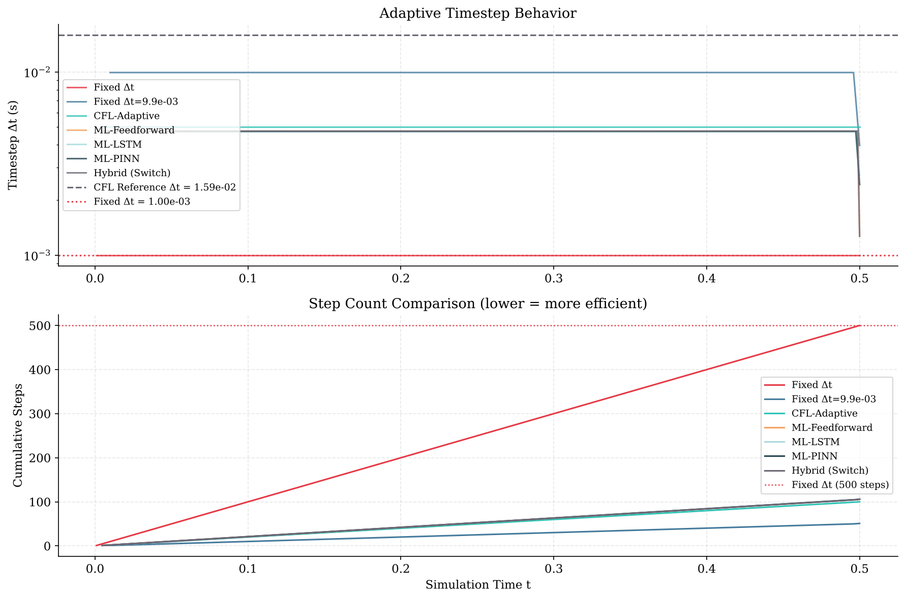
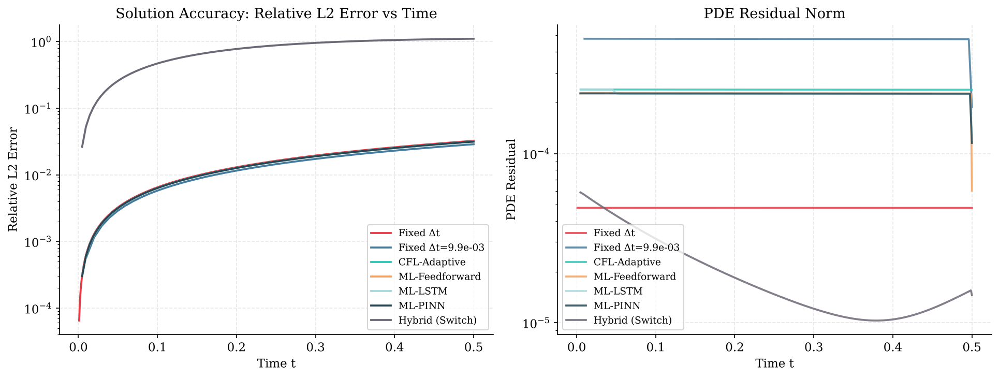
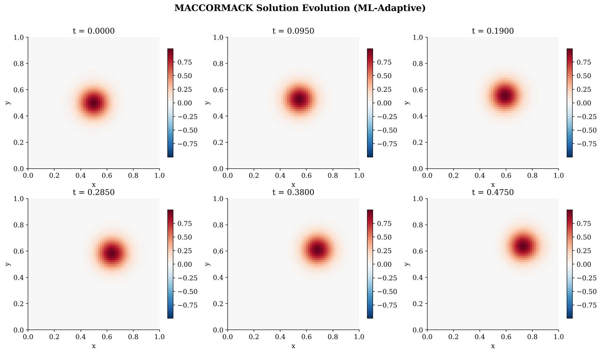
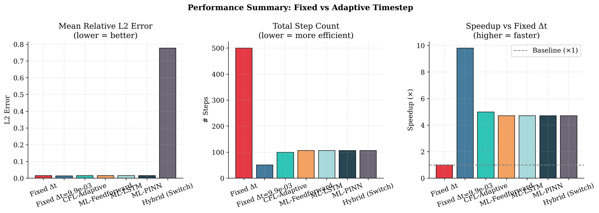
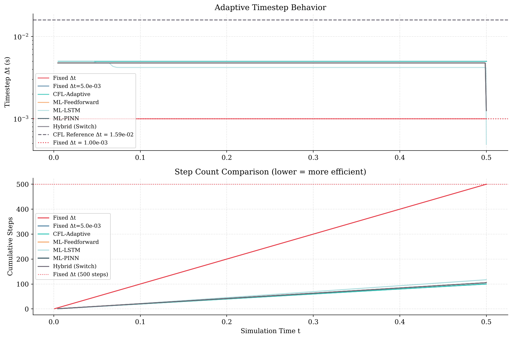
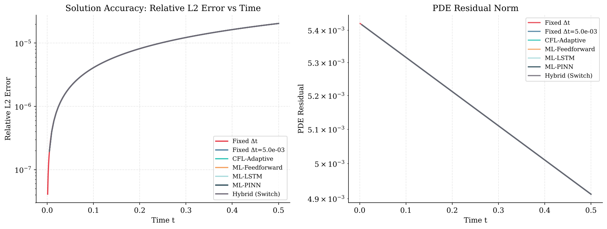
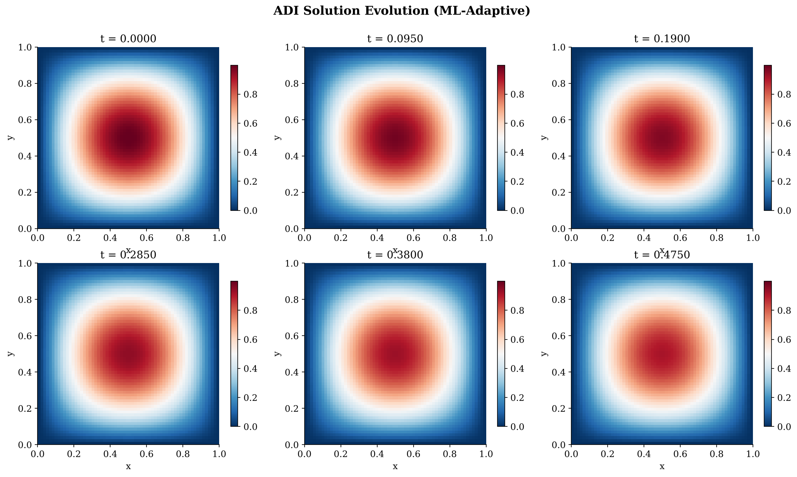
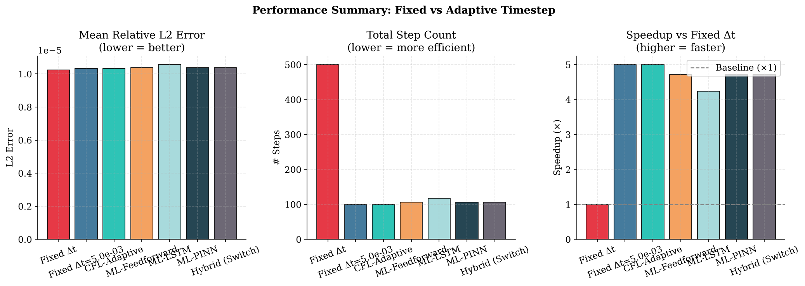

# Results

Produced on CPU with:

```bash
rm -rf data models results
MPLBACKEND=Agg python3 main.py
```

(64×64 grid, t_end = 0.5, 50 training simulations, up to 200 epochs with early
stopping, seed 42.) The files here are copied from `results/adi/` and
`results/maccormack/`. Wall times come from a single run.

Speedup is the step-count ratio against the `Fixed Δt` (1e-3) run. Mean L2 is
the relative L2 error against the analytic solution, averaged over all steps.
The second row of each table is a fixed step as large as the adaptive
controllers are allowed: the CFL-0.5 step for MacCormack, `DT_MAX` for ADI.

## MacCormack (2D advection) — [`maccormack/summary.csv`](maccormack/summary.csv)

```
  Method                    Steps   Speedup      Mean L2      Mean Δt  Wall [s]   Blowup
  ---------------------- -------- --------- ------------ ------------ --------- --------
  Fixed Δt                    500     1.00x   1.6254e-02    1.00e-03     0.218    No
  Fixed Δt=9.9e-03             51     9.80x   1.4872e-02    9.80e-03     0.022    No
  CFL-Adaptive                100     5.00x   1.5911e-02    5.00e-03     0.051    No
  ML-Feedforward              106     4.72x   1.6057e-02    4.72e-03     0.114    No
  ML-LSTM                     106     4.72x   1.6085e-02    4.72e-03     0.215    No
  ML-PINN                     106     4.72x   1.6022e-02    4.72e-03     0.113    No
  Hybrid (Switch)             106     4.72x   7.7731e-01    4.72e-03     1.276    No
```






## ADI (2D heat equation) — [`adi/summary.csv`](adi/summary.csv)

```
  Method                    Steps   Speedup      Mean L2      Mean Δt  Wall [s]   Blowup
  ---------------------- -------- --------- ------------ ------------ --------- --------
  Fixed Δt                    500     1.00x   1.0246e-05    1.00e-03     5.037    No
  Fixed Δt=5.0e-03            100     5.00x   1.0326e-05    5.00e-03     1.000    No
  CFL-Adaptive                100     5.00x   1.0326e-05    5.00e-03     0.972    No
  ML-Feedforward              106     4.72x   1.0392e-05    4.72e-03     1.184    No
  ML-LSTM                     118     4.24x   1.0564e-05    4.24e-03     1.428    No
  ML-PINN                     106     4.72x   1.0392e-05    4.72e-03     1.160    No
  Hybrid (Switch)             106     4.72x   1.0392e-05    4.72e-03     1.311    No
```






`Hybrid (Switch)` always selects ADI with the default parameters (Péclet number
≈ 0.79 < 1), so its MacCormack row is the heat equation applied to the
advection problem. See the Limitations section of the main README.
